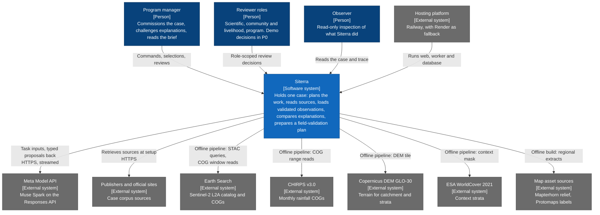

# Context and scope

Who and what Siterra exchanges information with, and where its boundary lies. The diagram is a C4 System Context diagram drawn as a Mermaid flowchart; the containers inside Siterra are in the [building block view](05-building-block-view.md).

## System context

In P0 the Meta Model API is the only external system called while a case runs; P1 adds `fetch_source` for public URLs and search grounding through the model provider. Observation sources and map sources feed offline preprocessing and asset builds; the demo path makes no live catalog query or raster export ([data sources and reproducible methods](../reference/data-sources-and-methods.md#access-and-delivery)).

## Business context

| Partner | Sends to Siterra | Receives from Siterra |
|---|---|---|
| Program manager (primary user) | Commission, typed commands (for example "Could drought explain this instead?"), area and period selections, answers to targeted questions | The case: plan and progress, evidence with provenance, map and charts, hypothesis ledger, livelihood constraints, candidate responses, field-validation plan, decision brief |
| Reviewer roles | Role-specific decisions with conditions and comments on exact entity versions | Review requests stating the proposed work, evidence, uncertainty, effects, required authority and alternatives ([review and authority](../reference/review-and-authority.md#review-requests)) |
| Observer or demo viewer | Nothing | Read-only case, trace and mode labels |
| Meta Model API | Typed proposals as structured final outputs, read and deterministic tool calls, usage | Task inputs: case summaries, retrieved source passages and PDFs, tool results |
| Publishers and official sites | Source documents, retrieved at setup from their official URLs, hashed and stored outside Git | Nothing |
| Earth Search, CHIRPS, Copernicus DEM, ESA WorldCover | Imagery, rainfall, terrain and context data for the offline pipeline | Nothing |
| Map asset sources | Relief and label extracts for the self-hosted regional bundle | Nothing |

People with land, community or program authority are outside the system. Siterra prepares; they decide ([human review and authority](../reference/review-and-authority.md)).

## Technical context

| Interface | Technology | Notes |
|---|---|---|
| Browser to Siterra | HTTPS with JSON; server-sent events for the case event stream; same-origin secure HttpOnly session cookies | Routes and stream behavior in the [runtime view](06-runtime-view.md#api-and-stream) |
| Siterra to Meta Model API | HTTPS to `https://api.meta.ai/v1` through the `openai` Node SDK; Responses API; every call streamed; `store: false`; strict JSON Schema structured output | Platform facts in [architecture constraints](02-architecture-constraints.md#model-platform) |
| Siterra to corpus sources | HTTPS retrieval at setup; P1 adds `fetch_source` through a server proxy that blocks private networks, with size and time limits | [Agent orchestration](../reference/agent-orchestration.md#tools-and-permissions) |
| Pipeline to Earth Search | STAC catalog queries month by month; windowed reads of red, NIR and scene classification COGs | Legacy `sentinel-2-l2a` collection; [observation preprocessing](../reference/observation-preprocessing.md) |
| Pipeline to CHIRPS | HTTP range reads of global monthly COGs for the area window | URLs, checksums and retrieval dates frozen in the manifest |
| Pipeline to Copernicus DEM | One COG tile from the AWS `copernicus-dem-30m` 2021 release; ETag and size verified | Catchment delineation and strata from the same pinned release |
| Asset build to map sources | Mapterhorn `planet.pmtiles` extract to z12; Protomaps daily build extract to z15 | Served from the application origin; no runtime third-party tile server ([deployment view](07-deployment-view.md#map-and-observation-assets)) |

## Out of scope

No interface exists for email or messaging, payments, scheduling, publishing, land-management execution, shell, arbitrary code, SQL or unrestricted browsing ([agent orchestration](../reference/agent-orchestration.md#tools-and-permissions)). No external-action endpoint exists in the API.
