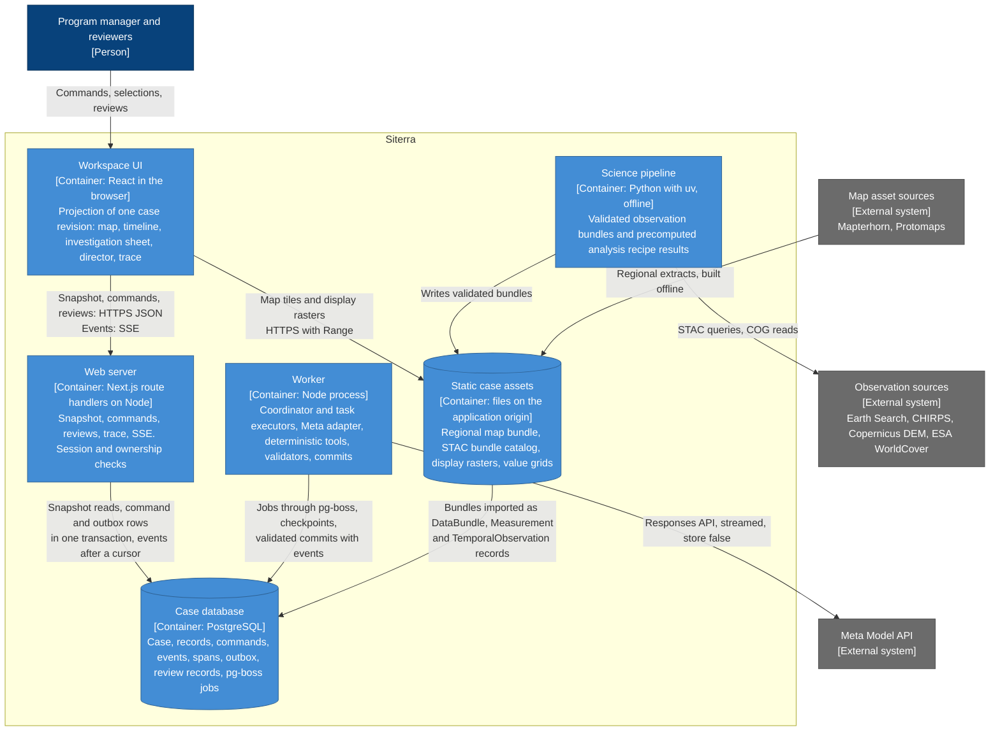

# Building block view

The containers Siterra is built from, the repository layout that holds them, and the building blocks inside the application. The container diagram is a C4 Container diagram drawn as a Mermaid flowchart; how the containers interact over time is in the [runtime view](06-runtime-view.md).

## Containers



| Container | Responsibility | Specification |
|---|---|---|
| Workspace UI | Renders one case revision as map, timeline, investigation sheet, director, inspector and trace; holds view state (period, focus, open inspector, camera) in the URL and React state | [UX architecture](../reference/ux-architecture.md), [components](../reference/components.md) |
| Web server | Validates session, ownership and expected revision; writes commands and outbox rows; serves snapshots, the event stream with replay, review submissions and the sanitized trace | [Runtime view](06-runtime-view.md#api-and-stream) |
| Worker | Runs the coordinator and bounded task jobs, calls the model through the adapter, runs read and deterministic tools, validates proposals and commits them with their events | [Agent orchestration](../reference/agent-orchestration.md) |
| Case database | The authoritative case record, the event log, internal spans, the outbox and the job queue | [Data contracts](../reference/data-contracts.md) |
| Static case assets | Self-hosted map bundle and observation assets under a versioned path, hash-addressed per manifest; ownership checked on every request | [Deployment view](07-deployment-view.md#map-and-observation-assets) |
| Science pipeline | Offline, reproducible preprocessing and analysis recipes; the application never computes these values itself | [Observation preprocessing](../reference/observation-preprocessing.md), [analysis recipes](../reference/analysis-recipes.md), [Siterra STAC extension](../../schemas/stac/siterra-extension.schema.json) |

The case corpus (sources retrieved at setup from their official URLs, hashed, stored outside Git) is read by the worker's `search_sources` and `read_source` tools; its manifest of source URLs and hashes is part of the case seed.

## Repository layout

Application layout:

```
apps/
  web/                Next.js App Router: UI, API routes, SSE
  worker/             Node worker: queue consumers, agent runtime
packages/
  contracts/          Zod schemas mirroring schemas/*.schema.json, types, fixtures
  domain/             commit validator, numeric provenance check, state machines, staleness, workspace projection
  agent/              Meta adapter, tool registry, task executors, prompts
  db/                 SQL migrations, queries
science/              Python pipeline (uv), outputs STAC bundles per schemas/stac/siterra-extension.schema.json
data/
  case/               case seed: geometry, corpus manifest (source URLs, hashes), config
  bundles/            validated bundles as a STAC static catalog: catalog.json,
                      <bundle-id>/collection.json, <bundle-id>/<period-id>/<period-id>.json and assets
  map/                regional map assets (PMTiles, terrain) and attribution
```

Bundles follow ADR-0028: one STAC Collection per bundle, one Item per period, a display raster as the `overview` asset and a value grid as the `data` asset; the importer maps them into `DataBundle`, `Measurement` and `TemporalObservation` records. Large raw downloads stay in the ignored `data/raw/` folder. Derived bundles are committed only if license-cleared and small (target under 50 MB in total); otherwise they are served from object storage with the same manifest hashes. Shared root files (`package.json`, `pnpm-workspace.yaml`, the base `tsconfig`, CI) belong to the platform lane.

Planning material that the application consumes or follows:

| Path | Contents |
|---|---|
| [`docs/`](../) | Explanation, reference, how-to, architecture, decisions and delivery documents |
| [`schemas/`](../../schemas/) | JSON Schema contracts and validated examples, consumed by `packages/contracts` and the science pipeline |
| [`design/`](../../design/) | Design tokens |
| [`research/`](../../research/) | Source registers and research notes behind the decisions |
| `data/raw/`, `data/interim/` | Ignored local downloads and unreviewed derivatives |

## Building blocks

| Block | Responsibility | Owning lane |
|---|---|---|
| `apps/web` | Workspace UI; `app/api` holds the route handlers and the SSE stream | Workspace UI; `app/api` belongs to platform |
| `apps/worker` | Queue consumers and the agent runtime | Agent runtime |
| `packages/contracts` | Zod schemas mirroring the JSON Schema contracts, types, fixtures; one catalog entry per component kind | Platform |
| `packages/domain` | Commit validator, numeric provenance check, state machines, staleness propagation, workspace projection | Platform |
| `packages/agent` | Meta adapter, tool registry, task executors, prompts | Agent runtime |
| `packages/db` | SQL migrations and queries | Platform |
| `science/` | Offline pipeline producing bundles and recipe results | Science and map data |
| `data/` | Case seed, validated bundles, regional map assets | Science and map data |
| `tests/`, `e2e/` | Acceptance suites, prohibited-claims and numeric scans, accessibility checks, performance traces | Quality |

Lane deliverables and dependencies are in the delivery plan.

### Inside the worker

| Part | Responsibility |
|---|---|
| Coordinator | Runs the `plan` task: turns a command and its context snapshot into a validated task graph of at most eight tasks |
| Task executors | One per task kind: source research, observation analysis, livelihood and governance research, hypothesis comparison, intervention feasibility, brief package |
| Meta adapter | Normalizes provider streams into `ModelDelta`, `ToolProposal`, `Usage`, `Completed`, `Refused`, `Incomplete` and `Failed`; provider event shapes never leave it |
| Tool registry | Read tools and deterministic compute tools only; budgets and deadlines come from host code |
| Validators | Completion, schema, references, claim rules, numeric provenance, prohibited claims, authority, transitions and limits |
| Commit | Writes accepted records, events and layout actions in one transaction against the expected case revision |

## Integration contracts

These must not change without the owning lane's approval:

- [`schemas/case.schema.json`](../../schemas/case.schema.json), [`schemas/stac/siterra-extension.schema.json`](../../schemas/stac/siterra-extension.schema.json) and [`schemas/openapi.json`](../../schemas/openapi.json), with the STAC profile for bundles (ADR-0028).
- The API routes in the [runtime view](06-runtime-view.md#api-and-stream) and the event kinds in [data contracts](../reference/data-contracts.md#events).
- The component catalog in [components](../reference/components.md#catalog-bindings).
