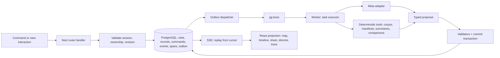
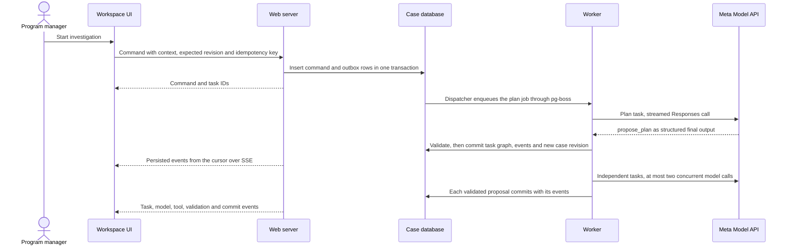

# Runtime view

How the containers cooperate at runtime: the data flow for every command, the HTTP API and event stream, and four scenarios (commission, drought challenge, review, reload). Record semantics are in [data contracts](../reference/data-contracts.md); task behavior is in [agent orchestration](../reference/agent-orchestration.md); the scenes these scenarios serve are in the [experience storyboard](../reference/experience-storyboard.md).

## Data flow

Command and outbox rows are inserted in one transaction; the dispatcher enqueues with a stable job key, so repeated dispatch is harmless. A task's accepted proposal, its events and the new case revision commit together; queue completion follows the commit. A crash between them is recovered by the result key in [agent orchestration](../reference/agent-orchestration.md#state-retry-and-recovery).

## API and stream

| Interface | Behavior |
|---|---|
| `GET /api/cases/:id` | Snapshot (case, records, `lastSequence`) from one transaction |
| `POST /api/cases/:id/commands` | Text, context with revisions, `expectedCaseRevision`, idempotency key; returns command and task IDs |
| `GET /api/cases/:id/events?after=` | SSE of persisted events from the cursor; `Last-Event-ID` honored; heartbeat comment about every 15 s; reset instruction if history is unavailable |
| `POST /api/commands/:id/cancel` | Cooperative cancellation |
| `POST /api/cases/:id/reviews` | Role, exact entity versions, decision, conditions, mode; stale versions rejected |
| `GET /api/cases/:id/trace?commandId=` | Spans and events for the trace inspector, sanitized |

Same-origin secure HttpOnly session cookies; ownership checked on every request including the stream and static case assets. A public demo session gets an isolated copy of the seed case with quotas and expiry. No external-action endpoints exist.

Event sequence numbers are per case, gapless and monotonic; `dedupeKey` makes re-delivery harmless; heartbeats are SSE comments, not events ([data contracts](../reference/data-contracts.md#events)). The routes and the stream are described once in OpenAPI 3.2 as `schemas/openapi.json` (ADR-0031): the stream route returns `text/event-stream`, each Server-Sent Event is modeled with `itemSchema`, and the JSON in its `data` references the Event definition in [`case.schema.json`](../../schemas/case.schema.json).

## Scenario: commission

The user commissions the case from the arrival screen ([scene 2](../reference/experience-storyboard.md#scene-2-commission)).

1. The workspace sends `POST /api/cases/:id/commands` with the text, the context (area, period, focus, each with its revision), `expectedCaseRevision` and an idempotency key. A repeated key returns the existing command.
2. The web server validates session, ownership and revision, inserts the command and outbox rows in one transaction and acknowledges with command and task IDs (`command.accepted`). Target: acknowledgement within 1 s, first real progress within 2 s (PF-05).
3. The dispatcher enqueues the plan job. The worker runs the `plan` task: it reads the case, calls the model with the context snapshot and receives `propose_plan` as the structured final output.
4. Validators check the proposal in order (completion, schema, references, claim rules, numeric provenance, prohibited claims, authority, transitions and limits); the commit writes the task graph (at most eight tasks), its events and the new case revision in one transaction.
5. Independent tasks start: source research, observation analysis, livelihood and governance research. At most two model calls per case run concurrently; the commit boundary stays serial per case.
6. The workspace receives events over SSE. Plan rows appear only when `task.queued` events arrive; the director receipt shows the user's words, then the planner's one-sentence interpretation once committed.
7. The command completes only when every task is terminal, accepted changes are durable, components resolve and the brief lists unresolved dependencies (`command.completed`). In live mode the plan has at least four model-proposed tasks that reach a terminal state with no manual step (AF-01).

A planner failure leaves the prior state intact and preserves the input; a clarifying question appears as a director prompt.

## Scenario: drought challenge

The user asks "Could drought explain this instead?" with Area, Period and Focus chips set ([scene 5](../reference/experience-storyboard.md#scene-5-competing-explanations-signature), ADR-0008).

1. The command carries the visible context with revisions; changing the selection while it runs does not retarget it.
2. The planner adds tasks. Deterministic tools load the rainfall bundle and align the series with `compare_series`: aligned departures on shared period IDs and the same area revision, counts of same-sign months, prespecified 0 to 3 month antecedent windows, no causal statistics.
3. The `hypothesis_comparison` task writes typed hypotheses and relationships from records only: supporting, contradicting and missing evidence with a status word, never a probability. The numeric provenance check runs before the commit.
4. The commit adds rainfall measurements, observation evidence, hypothesis revisions, relationships and the layout actions for the hypothesis ledger and an aligned temporal comparison. If the layout proposal is rejected, the reducer's default projection places the results.
5. The workspace opens Explanations with the ledger and aligned panels; the map adds the native rainfall grid outline; the timeline adds a rainfall departure row.

Rainfall may end "Consistent with available evidence" while grazing ends "Cannot be assessed with current data" with its missing evidence listed. Without a rainfall bundle the rainfall hypothesis is "Cannot be assessed" with the named dependency. The new tasks' model and tool events are timestamped after the command, and no canned response path exists in live mode (AF-02).

## Scenario: review

A reviewer records a role-specific decision on the prepared package ([scene 9](../reference/experience-storyboard.md#scene-9-human-review), [human review and authority](../reference/review-and-authority.md)).

1. The `brief_package` task has produced the field-validation plan (`OperationalAction`, `draft → awaiting_review`), the decision brief and review requests per role through `request_review`, each bound to exact entity versions.
2. The review view shows the proposed work, evidence, uncertainty, effects, required authority, alternatives and remaining conditions for each role panel.
3. The workspace sends `POST /api/cases/:id/reviews` with role, exact entity versions, decision, conditions and mode. The server rejects stale versions; if the case changed since the view loaded, decisions are disabled with "Case changed; review the current version".
4. The server stores a `ReviewDecision` with `mode: demo`, emits `review.recorded` and recomputes the action status. Nothing external happens.
5. The community and livelihood role cannot be completed inside the demo; its panel offers only "Mark consultation required". The action can reach "Prepared (demo)" with "Community consultation outstanding" still listed.

A later material change to data, method, area or scope creates a new revision and marks dependent approvals stale through `entity.stale`; prior decisions stay readable.

## Scenario: reload

The user reloads at any point or returns later ([scene 10](../reference/experience-storyboard.md#scene-10-continuity)).

1. The URL holds case, period, focus, view and open inspector, so the view state restores.
2. `GET /api/cases/:id` returns the case, its records and `lastSequence` from one transaction.
3. The workspace opens `GET /api/cases/:id/events?after=` from `lastSequence`; the server replays persisted events from the cursor and honors `Last-Event-ID`.
4. The client ignores sequences at or below its cursor; a gap triggers a snapshot refetch.
5. No completed task re-executes and nothing is replayed for show (RL-04). On network loss the workspace shows the last saved snapshot read-only with "Reconnecting" and resumes the stream from the last sequence (RL-03).

Failure scenarios (source unavailable, malformed model output, missing input, conflicting revision, stream interruption, budget limit) are listed in the [experience storyboard](../reference/experience-storyboard.md#required-failure-scenes); the shared rules are in [cross-cutting concepts](08-cross-cutting-concepts.md#failure-behavior).
