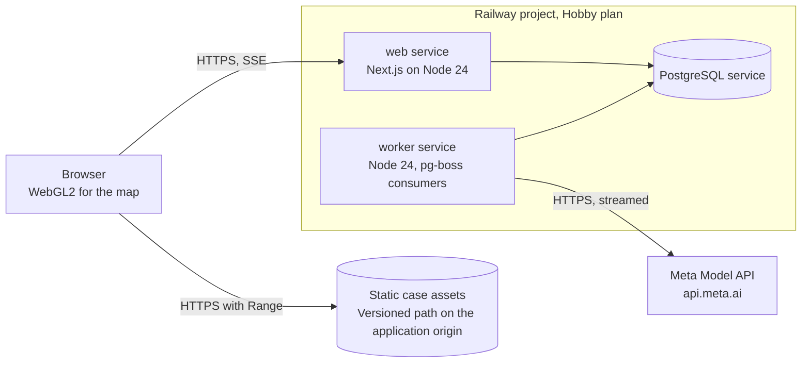

# Deployment view

Where the containers run, how map and observation assets are served, and what a deployment must prove before it is used. Hosting limits are in [architecture constraints](02-architecture-constraints.md#hosting-limits); the hosting decision is ADR-0017.

## Infrastructure

## Hosting

**Default: Railway Hobby plan** (web, worker and PostgreSQL as services in one project) [D]. Railway's per-request limit for SSE makes the 15-second heartbeat and `Last-Event-ID` reconnect required, not optional (TECH-50). Do not deploy on the trial: an unverified limited trial restricts outbound network, which would block `api.meta.ai`.

**Fallback: Render** (responses up to 100 minutes; paid background worker and Postgres, roughly USD 20 per month at list prices) (TECH-51). Rejected: Vercel for the worker (function duration limits, no persistent process; Hobby is non-commercial) and Fly.io (managed Postgres price) (TECH-52, TECH-53). Behind any proxy, disable response buffering on the SSE route (`X-Accel-Buffering: no`) (TECH-54). Spending on any plan is the founder's decision.

| Environment | Runs | Notes |
|---|---|---|
| Local development | Web, worker and PostgreSQL | Its own model API key, separate from the deployed worker's |
| Deployed | Web, worker and PostgreSQL as Railway services | Same Node major version as local; account spend alert set on day 1 |
| Local deployment (fallback) | The same services with a persistent database | Labeled; the submission text says the demo ran locally |

A public demo session gets an isolated copy of the seed case with quotas and expiry. Credentials live in a secret store, never in files ([CONTRIBUTING.md](../../CONTRIBUTING.md#public-and-private-placement)).

## Deployment checks

The hosting gate (GATE-04 in the delivery plan) passes only when, on the deployment:

- the worker survives the browser closing;
- the SSE stream reconnects across the 15-minute request cap;
- map asset requests with an HTTP Range header return 206.

If it fails: Render, then the local deployment with disclosure. All P0 acceptance tests must pass on the deployment (definition of done).

## Map and observation assets

Self-hosted regional bundle, no runtime third-party tile server ([map assets](../../research/technology/map-assets.md)):

| Asset | Source | Attribution |
|---|---|---|
| Relief DEM (hillshade, terrain, contours) | Mapterhorn `planet.pmtiles` extract to z12 (Copernicus GLO-30 derived), unpacked to z/x/y for contours | "© Mapterhorn" plus the Copernicus WorldDEM-30 notice |
| Labels, water, roads | Protomaps daily build extract to z15 (OSM, ODbL) with Noto Sans glyphs | "Protomaps © OpenStreetMap" linked to the copyright page |
| Observation rasters | Siterra bundles: per-period RGBA WebP or PNG as MapLibre `image` sources | "Contains modified Copernicus Sentinel data [years]" |

Extents follow the analysis catchment (bbox `-6.54125,31.49403,-6.14236,31.75625`, [data sources and reproducible methods](../reference/data-sources-and-methods.md#study-area)): display extent `-6.61,31.43,-6.08,31.82` (catchment plus about 0.06°), asset extent `-6.71,31.33,-5.98,31.92` (plus about 0.16° so relief and contours have neighbour tiles). These extents take precedence over the locator-centered box in the map assets note and are display extents only.

Serving gate: HTTP Range requests must return 206, otherwise serve z/x/y tiles. Map and observation assets are static files under a versioned path on the application origin, hash-addressed per manifest. Chart values come from manifests, never from pixels. If WebGL2 is unavailable, show a static attributed relief image built from the same sources and the area as text.

Derived bundles are committed only if license-cleared and small (target under 50 MB in total); otherwise they are served from object storage with the same manifest hashes.
