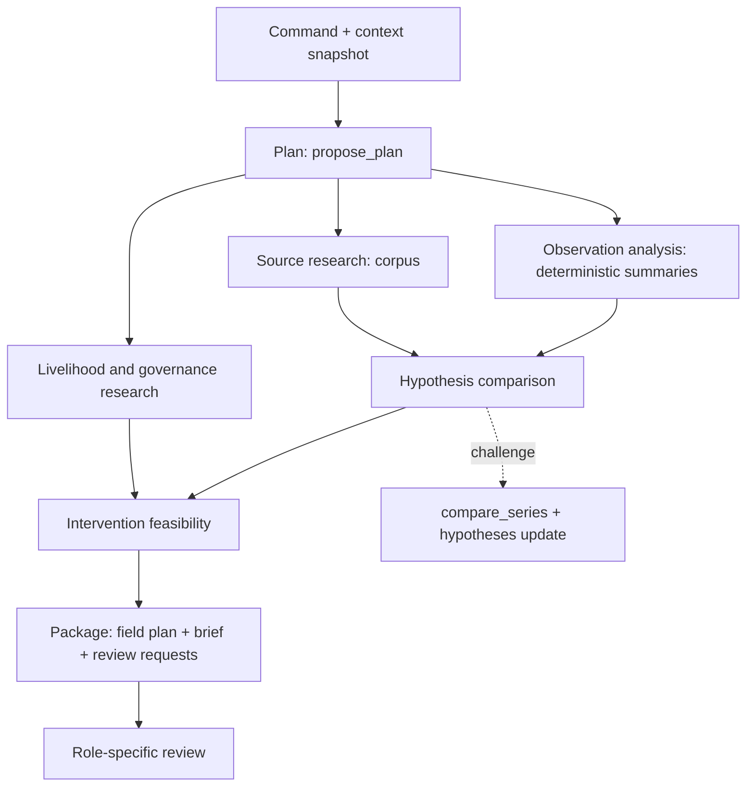

# Agent orchestration

This document owns task boundaries, tools, validation, budgets and recovery. The [architecture](../architecture/README.md) owns system layout and the model adapter; [Data contracts](data-contracts.md) owns record and tool-argument types; [Human review and authority](review-and-authority.md) owns authority. `TECH-*` IDs resolve in the [technology register](../../research/technology/source-register.md).

## Shape of the autonomy

**One coordinator and bounded task jobs** [D]. They may share one Meta model and one worker process. An agent here is a task with an input snapshot, a tool allowlist, a typed result, a budget, a deadline, dependencies and a trace; it is not a persona or a conversation. Multi-agent parallelism is not a claim the product makes (it is a commodity, see [competitive position](../explanation/competitive-position.md)).

The user commissions once. The coordinator plans; tasks retrieve and check sources, request deterministic summaries of validated observations, compare explanations, surface livelihood constraints, screen responses and compose the field-validation package. When data quality or a missing input blocks a conclusion, the result says exactly what is missing and the next plan includes the step that would supply it.

Independent tasks run concurrently after the plan is validated, with at most two concurrent model calls per case. Each task writes typed proposals; the commit boundary is deterministic and serial per case.

## Models

Each Meta model has one job and a check that does not depend on it ([ADR-0041](../decisions/0041-give-each-meta-model-one-job-with-an-independent-check.md); facts and limits in the [Meta models research](../../research/technology/meta-models.md)).

| Job | Model | Independent check | Priority |
|---|---|---|---|
| Plan, read sources, compare, compose | `muse-spark-1.3` | Validators below | P0 |
| Read source PDFs (page ranges of at most 50 pages) | `muse-spark-1.3` file input | Verbatim excerpt on the cited page | P0 |
| Second reader for statement faithfulness | Muse Glimmer 30B, local, pinned | Gold set in the [evaluation harness](evaluation.md) | P1 |
| Imagery quality review | `muse-spark-1.3` image input | Scene classification fractions | P1 |
| French drafts | `muse-spark-1.3` | Provenance and claim checks, local review | P1 |
| Field-protocol illustrations | Muse Image, search and shell off | Spark checklist, community and livelihood review | P1 |
| Push-to-talk | Muse Voice Transcribe | Person edits and submits | P1 stretch |
| Brief critique | Muse Wonder | Person accepts or dismisses | P2 |
| Candidate cropland mask | Segment Anything | Agreement with WorldCover | P2 |
| Cited drought event record, built at setup ([ADR-0045](../decisions/0045-extend-the-meta-model-map-to-event-records-figures-and-whole-corpus-reading.md)) | `muse-spark-1.3` on stored source text; `web_search` for leads only in the P1 extension | Excerpt, date and scope rules; rainfall direction against the catchment record; sampled human review | P0 minimum (SCI-25, no search); P1 French and Arabic reports with `web_search` leads |
| Place a published figure on the valley (ADR-0045) | `muse-spark-1.3` spatial grounding | Gazetteer fit with leave-one-out error | P1 |
| Find where sources disagree (ADR-0045) | `muse-spark-1.3`, whole corpus in one request | Both excerpts verbatim; person accepts | P1 |
| Snow through monthly composites (ADR-0045) | Segment Anything on video | Agreement with Scene Classification | P1 experiment |

Every model call records model ID, route (Model API, local or provider), request ID and provider usage fields. The "Models in this case" sheet and the README model map are generated from the routing configuration. A PDF contributes text from its first 100 pages and images from its first 50 only, so long documents are sent in page ranges and token-counted before their first read.

## Tasks

| Task kind | Inputs | Tools | Result and completion rule |
|---|---|---|---|
| `plan` | Command text, context snapshot, case summary | `read_case`, `propose_plan` | Validated task graph (at most 8 tasks), one-sentence interpretation, optional clarifying question. Unknown task kinds or tools are rejected |
| `source_research` | Question, scope, corpus | `search_sources`, `read_source`, `propose_evidence` | Located `scientific_context` evidence with source ID, locator, excerpt (300 characters max), scope note and limitations. Unread or unavailable sources are flagged, never summarized |
| `observation_analysis` | Validated bundle IDs, period range | `read_dataset_manifest`, `summarize_observations`, `propose_evidence` | `observation` evidence referencing measurement IDs; coverage and quality flags carried; all numbers from tool results |
| `livelihood_governance` | Question, region, corpus | `search_sources`, `read_source`, `propose_evidence` | Published-context evidence and `field_requirement` items for unknown local facts; no household counts, contacts or consent claims |
| `hypothesis_comparison` | Accepted evidence, candidate explanations | `read_evidence`, `compare_series`, `propose_hypotheses`; P0 adds `read_event_record` and `compare_events` | Hypotheses with supporting, contradicting and missing evidence and a status word; relationships. No probabilities |
| `intervention_feasibility` | Hypotheses, constraints, sources | `read_evidence`, `read_source`, `propose_interventions` | Conditional options with assumptions, considerations, prerequisites and required review roles; no benefit numbers |
| `brief_package` | Accepted records | `read_case`, `propose_package`, `request_review`, `propose_layout` | Draft field-validation plan, brief items each with evidence IDs, review requests per role. Blocks "ready for review" if a critical dependency is missing |
| `validation` | Any proposal | Deterministic validators (host code, not a model) | Accept, partial or reject with machine-readable issues |

Layout proposals (`propose_layout`) may accompany any result task; if absent, the reducer's per-kind default applies ([UX architecture](ux-architecture.md#ai-composition-contract)).

### Transport of proposals

The Meta Responses API accepts only `tool_choice: "auto"`, so a tool call cannot be forced (TECH-07). Each task therefore ends with its proposal as the response's **structured final output** (`text.format` json_schema, strict subset, generated from Zod); the `propose_*` names in this document and in [Data contracts](data-contracts.md#tool-argument-contracts) are those output schemas. Function tools are offered only for reads and deterministic computation. A task whose model turn ends without a schema-valid proposal gets one repair turn, then fails. The last two rounds of every task offer no tools: one for the proposal and one for its repair. Host code asks for the proposal when the first of them starts. A tool call in either round is answered with an error and not run, so a task that keeps reading fails at the round limit.

### Source reading

In P0, `read_source` returns the source's extracted text by page and, for PDFs, the task may also pass the original file to the model (Muse Spark accepts PDF input, TECH-03) so French-language and table content is read in context. Every excerpt in a proposal must be found verbatim in the extracted text of the cited page (whitespace-normalized); otherwise the item is rejected with `excerpt_mismatch`. English statements drawn from non-English sources are labeled "Machine-drafted translation" with the original excerpt shown.

### Event record (P0 minimum, P1 search and reports)

The event record is built at corpus setup, not during a command, and imported as a validated event bundle with a manifest (model ID, prompt version, source hashes, date, rows proposed and rows accepted). The P0 minimum reads only the stored text of the FAO GIEWS Morocco archive (SCI-25), one request per brief, with no search step. In the P1 extension a person runs a search step: `web_search` results are leads only; a lead becomes a source when the setup step fetches and stores it, and every excerpt is checked against that stored text, never against a search snippet. Each row passes, in host code: the verbatim excerpt check; event date or period not later than the publication date; a scope (`national`, `region`, `province`, `valley`) that must match a place name inside the excerpt, defaulting to `national`. Rows that fail are kept out of the bundle and counted in its manifest.

During the drought challenge, `read_event_record` returns rows for the case period and `compare_events` (deterministic) sets, for each row that states a rainfall direction, `agrees`, `does_not_agree` or `no_matching_period` by the [`season_summary`](analysis-recipes.md) recipe: the event maps to its November to April wet season (a start in November or December of year *y* maps to the season starting November *y*, any other month to the season starting November *y* - 1), and its stated direction is compared with that season's tercile category against the 30 wet seasons starting November 1991 to November 2020. Until that recipe's precomputed result exists, it returns no result. A national statement can disagree with the catchment and still be true for its own area. Rows enter the ledger as `scientific_context` evidence with their scope; they never count as observations and never support a causal claim.

### Figure placement and corpus comparison (P1)

Figure placement is a setup step: the model returns points at printed place labels on a page image; host code matches labels to the gazetteer, fits the transform, computes leave-one-out error and keeps the layer off below 4 matched points or above the threshold recorded before the run. The model never draws or edits the figure. Corpus comparison is a task step inside `hypothesis_comparison`: one request carries the extracted corpus text first and the question last; each proposed contradiction carries two excerpts that both pass the verbatim check, and a person accepts it before the ledger shows "Sources disagree".

### Imagery quality review (P1)

An optional `imagery_review` step sends monthly true-color thumbnails to the model and asks for visible snow, cloud and shadow flags. Flags are compared with Scene Classification fractions from the bundle; agreements add confidence to existing quality flags, disagreements appear as "QA disagreement" for human inspection. Model flags never change measurements.

## Tools and permissions

| Tool | Kind | Scope and gate | P |
|---|---|---|---|
| `read_case`, `read_evidence` | Read | Current authorized case; returns records by ID and revision | P0 |
| `search_sources` | Read | P0: keyword and section search over the case corpus (sources retrieved at setup from their official URLs, hashed, stored outside Git). P1: web search through the provider's grounding feature, results treated as leads | P0 |
| `read_source` | Read | Returns passages of a retrieved corpus source by ID and locator | P0 |
| `fetch_source` | Read | P1: fetch a public URL through a server proxy that blocks private networks and redirects to them, with size and time limits; output sanitized and stored as an unverified source | P1 |
| `read_dataset_manifest` | Read | Registered, validated bundles only | P0 |
| `summarize_observations` | Deterministic compute | Registered summaries over a validated bundle: per-period values, seasonal summaries, departures, coverage counts, with parameters (window, months, exclusions such as snow-flagged months). New parameters produce new measurement revisions | P0 |
| `list_recipes` | Read | Analysis recipe catalog with applicability computed from the bundle; inapplicable recipes returned as blocked with the reason ([analysis recipes](analysis-recipes.md)) | P0 |
| `read_recipe_result` | Read | A precomputed recipe result by recipe, version, scope and bundle, labeled "precomputed analysis" | P0 |
| `read_event_record` | Read | Validated event bundle rows for the case period, with scope and source locator | P0 |
| `compare_events` | Deterministic compute | For event rows that state a rainfall direction, agreement of that direction with the tercile category of the row's November to April wet season (`season_summary` recipe); no averaging of text into numbers | P0 |
| `compare_series` | Deterministic compute | Aligns two validated series on shared period IDs and the same area revision; returns aligned departures, counts of same-sign months, prespecified 0 to 3 month antecedent windows. No causal statistics, no fitted attribution | P0 |
| `propose_plan`, `propose_evidence`, `propose_hypotheses`, `propose_interventions`, `propose_package`, `propose_layout` | Proposal | Typed arguments ([Data contracts](data-contracts.md#tool-argument-contracts)); nothing is written until validation and commit | P0 |
| `request_review` | Proposal | Creates review requests for exact entity versions and roles; grants nothing | P0 |

Muse Code and any code execution stay outside the product runtime; analysis depth comes from the recipe catalog, not from model-written code ([ADR-0036](../decisions/0036-run-analyses-as-declarative-precomputed-recipes.md)). Map scenes are proposed with `propose_scene` in P1 ([scenes and views](scenes.md)).

Not exposed, in any phase of this build: shell, arbitrary code, SQL, filesystem writes, unrestricted browsing, generic HTTP mutation, email or messaging, payments, scheduling, publishing, land-management execution. Retrieved text is untrusted evidence; it can never change tools, permissions or instructions. Budgets and deadlines come from host code and cannot be raised by the model.

## Validation

Every proposal passes these checks in order; any failure rejects the proposal (or the failing items, for partial results) and records a `validation.completed` event with issues.

1. **Completion:** the provider response finished (not refused, not incomplete) and the tool arguments are complete. Streaming partial arguments never update the case.
2. **Schema:** strict parse with the shared Zod schema; extra fields and unknown names rejected.
3. **References:** every ID exists in this case at the expected revision; inputs not stale; geometry and period compatible.
4. **Claim rules:** `observation` must cite measurements; `scientific_context` must cite a retrieved source locator; `verified_outcome` is rejected in P0; status words must match the evidence (an `inconclusive` hypothesis needs missing evidence), and model text that restates a hypothesis carries its status word in the same sentence.
5. **Numeric provenance:** every number in model-written text must match a value in a referenced measurement (within its displayed precision), a date or period, or a number inside a cited excerpt. Anything else is rejected. This is the guard against model arithmetic and invented figures.
6. **Prohibited claims:** a phrase scan for the claims listed in [Scientific basis and limits](../explanation/scientific-basis.md#claims-prohibited-in-the-demo) (diagnosis, carrying capacity, biomass, forecasts, consent, outcomes).
7. **Authority:** proposed actions stay within `prepared`; required review roles present; `externalExecutionEnabled` false.
8. **Transitions and limits:** allowed state transitions only; layout limits enforced.
9. **Commit:** accepted records, events and layout actions written in one transaction against the expected case revision.

A model may be asked once to repair a rejected domain proposal, given the issues. A second rejection fails the task with the issues visible in the trace. Layout proposals are exempt: a rejected `propose_layout` is recorded with its issues and the reducer's default projection places the results, because a repair call would only fix presentation (rule PRES-07 in [Data contracts](data-contracts.md#presentation-contract)).

## State, retry and recovery

- Checkpoint after every completed tool call and accepted proposal; record input hashes, prompt and adapter versions and model ID.
- Logical result key `(caseId, commandId, task kind, inputHash)`: a retry that finds a committed result returns it.
- Retry only transient failures: 429, 500 and 503 (honor `Retry-After`; 60 s for overload), and streams that time out before the first event or go idle. Two retries with jitter. Never retry 400, 401, 402, 403, 404 or 413 unchanged; never blindly retry a non-streaming 504 (all calls stream). Authentication, permission, missing data and unsafe requests do not retry (TECH-30).
- Worker restart reclaims unfinished jobs and reads checkpoints before repeating tools. Tools are read-only or deterministic, so repetition is harmless; commits are idempotent.
- A failed dependency fails its dependents, with one exception: the brief package runs once every task it reads has ended, so the field-scoping package completes when a quantitative task fails (RL-02). Each failed task is named in its missing inputs and the package stays a draft, not ready for review.
- Cancellation is cooperative: checked before each model turn, tool call and commit. Accepted evidence is never erased.
- A spend guard stop is not cooperative. The operator's spend guard sends the worker `SIGUSR2`; the worker aborts the running command at once, model calls in flight included, then stops. The command ends `cancelled`, every task it stopped records the failure code `spend_guard`, and a stopped task commits no evidence. `SIGINT` and `SIGTERM` stay graceful: the running job finishes first.
- **Staleness:** when a measurement, bundle, geometry or summary parameter changes, every record whose provenance cites the old version becomes `stale` (event `entity.stale`), including hypotheses, brief items and review decisions. Re-running produces new revisions; history stays readable. This is what acceptance test DF-03 checks.

## Budgets (P0 defaults, host-enforced)

| Limit | Default | On reaching it |
|---|---|---|
| Model and tool rounds per task | 6, the last 2 without tools | Partial result naming the unfinished question |
| Tasks per command | 8 | Planner narrows scope or asks a clarifying question |
| Concurrent model calls per case | 2 | Queue |
| Source searches per command | 10 | Use collected sources; disclose coverage |
| Model stream: first event / inactivity | 20 s / 30 s | Abort, retry policy, then partial |
| Command wall clock | 180 s | Stop new work; assemble a partial package |
| Estimated model and search spend per command | USD 0.50 | No new calls; show the exhausted state |

Reserve estimated cost before each call, reconcile with reported usage, include retries. Pricing basis and rechecks: [architecture constraints](../architecture/02-architecture-constraints.md#model-platform). Only a human can raise a budget.

## Honest trace and completion

The trace shows task, state, dependencies, timing, model calls (model ID, tokens, duration, status, provider request ID), tool calls (name, sanitized argument summary, result IDs, duration, attempt) and validation outcomes. Event messages are rendered by host templates, never by the model. No raw prompts, keys or hidden reasoning reach the browser.

Milestones are facts: "Retrieved 6 of 7 sources" only when six retrievals succeeded. Precomputed observations are labeled precomputed; live work is labeled live. A command completes only when every task is terminal, accepted changes are durable, components resolve, and the brief lists unresolved dependencies. "Prepared" is the terminal P0 state for actions; no review in the demo implies consent, field validation or an environmental outcome.

## Naïve and other runtimes

Omit from P0 and P1 [D]. Siterra needs a short, bounded, read-only evidence pipeline, not company identities, wallets or unrestricted computers, and an extra runtime adds account, policy and failure surface without improving case results (TECH-24 to TECH-26). Extension point: an `ExecutionBackend` interface that accepts the same typed task envelope and normalizes events, with PostgreSQL staying authoritative. Reconsider only after the baseline passes acceptance.
