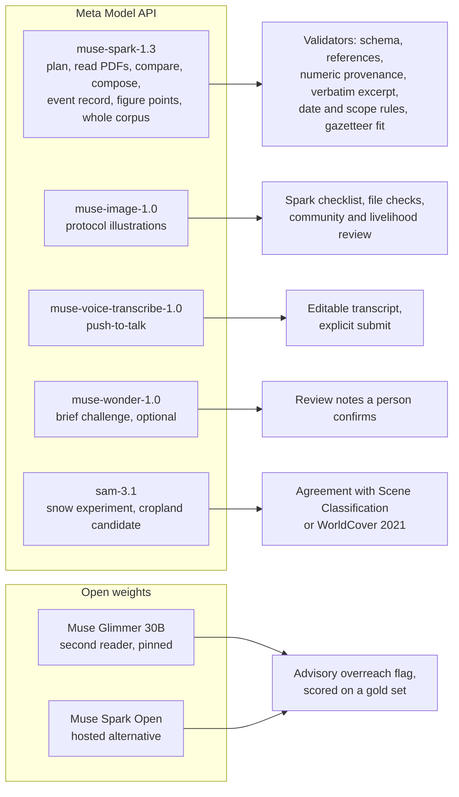

# Meta models: verified capabilities and the Siterra model map

Research checked 2026-10-26 (event kickoff day); additions checked 2026-10-27 against the Markdown versions of Meta's documentation pages (sources MM-27 to MM-31). Public research note: facts with sources, no credentials, no account details and no event tactics (those stay in local notes per the [documentation policy](../../CONTRIBUTING.md)). Documentation inspection establishes advertised capability, not successful integration, account access or measured quality. No dependency was installed, no account was used and no authenticated call was made. Local smoke tests of an open-weight model that was already installed on the planning machine are recorded below and labeled as such.

Labels follow the [planning index](../../docs/README.md#evidence-labels): **[V]** checked against the cited primary source on this date, **[U]** unverified, **[H]** hypothesis. Sections marked **Recommendation** are engineering judgment; they become decisions only through a decision record in decisions. Source IDs `MM-*` are owned by this note and listed at the end; `TECH-*` IDs refer to the [technology register](source-register.md), which this note extends and does not repeat.

## Findings and recommendations

- `muse-spark-1.3` stays the workhorse (ADR-0015). One new limit matters for P0 source reading: a PDF contributes text from its first 100 pages and page images from its first 50 only (MM-18). Long theses must be sent in page ranges.
- Meta publishes two open-weight models. Muse Glimmer is a 30B dense model under Apache 2.0 that runs on one 24 GB GPU or an Apple silicon Mac with enough unified memory. Muse Spark Open is an 816B mixture-of-experts model under the Muse Model License that needs a multi-GPU server or two to four linked Mac Studios, or a hosted provider (MM-06 to MM-13).
- Hosted Muse Spark Open is priced exactly like `muse-spark-1.3` Standard at Fireworks, Baseten and OpenRouter (MM-14). There is no cost reason to move Spark work to it. Hosted Glimmer costs roughly a quarter to a third of Spark per token, and local Glimmer has no per-token charge.
- **Recommendation:** give open weights a job that Spark cannot do for itself: a second reader with different, pinned, publicly available weights that checks every English statement against its verbatim source excerpt for overreach, measured on a gold set against Spark and human labels.
- **Recommendation:** use Muse Image only for clearly labeled illustrations of field-protocol steps, with its web and image search switched off, and never for anything that could pass for a place, a measurement or a person.
- Meta documents no embeddings endpoint, no hosted guard or moderation model, no batch endpoint and no evaluation service on Model API (MM-24; the Files API accepts `purpose=batch` uploads, but no batch endpoint is published). Retrieval stays keyword and section search; safety stays deterministic validators, with Llama Prompt Guard 2 as an optional screen.
- **Recommendation (ADR-0045, proposed):** four more checked jobs use capabilities the first map left idle: a cited drought event record built with Spark from stored reports (search grounding only for P1 leads), a published figure placed on the valley from Spark's spatial grounding, a whole-corpus comparison in one long-context request, and a Segment Anything snow experiment on a video of monthly composites. Each has a check that does not depend on the model.

## Verified capabilities by model

### Muse Spark (`muse-spark-1.3`): additions to TECH-03 to TECH-09

| Fact [V] | Implication for Siterra |
|---|---|
| PDFs are converted to text plus per-page images. Text comes from the first 100 pages, images from the first 50; a request carries at most 50 images. Inline files up to 50 MB, Files API up to 1 GiB; uploads never expire unless `expires_after` is set; 100 GiB storage per team (MM-18) | Split long PDFs into page ranges of at most 50 pages before sending, keep the page offset so excerpt verification still cites original page numbers, and set an expiry on uploads |
| Image input cost scales with resolution; Meta measured roughly 1,300 to 1,500 tokens for a ~1280 px image. `POST /v1/responses/input_tokens` returns the exact input count without generating (MM-18, MM-19) | Measure each corpus PDF's token cost before its first read instead of estimating it |
| Meta states that audio understanding on 1.3 is not fully supported and points to Muse Voice Transcribe for speech (MM-04) | Never send microphone audio to Spark |
| Image understanding can return points, boxes and counts on a normalized 0 to 1000 grid when asked for structured coordinates (MM-18) | Optional: localize snow or cloud in the P1 imagery review; still never a measurement |
| Responses usage reports `input_tokens_details.cached_tokens` and `output_tokens_details.reasoning_tokens`; Meta's injected steering tokens are not billed (MM-05, MM-19) | The usage meter reads these fields; it never estimates |
| The published API reference covers Responses, Chat Completions, Messages, Files, Models, Status, Images and Voice only; file uploads accept `purpose=batch`, but no batch endpoint is documented (MM-18, MM-24) | No Meta embeddings, batch, moderation or evaluation endpoint to plan around |
| Spatial grounding has three documented shapes: a point, a box, or points plus a count, on the 0 to 1000 grid of the image actually sent; Meta advises asking for one shape, listing the objects, and keeping the system prompt minimal (MM-18). Meta's chart cookbook warns that numbers read off axes vary across identical calls and are sometimes misread, and verifies each one (MM-29) | Use grounding to locate printed labels, never to read values; code converts coordinates and checks them against an independent source |
| Search grounding is the `web_search` tool on Responses and Messages, not Chat Completions; USD 2.50 per 1,000 queries plus tokens; `include: ["web_search_call.results"]` returns title, URL and the snippet the model saw; `url_citation` annotations carry character offsets; `user_location.country` biases locale; the Responses schema lists a `filters` object on the tool ("Filters that narrow the search") without documented fields [U: what it accepts], on Messages `allowed_domains`, `blocked_domains` and `max_uses` return 400, and no language filter is documented; the model decides whether to search; Meta states that multi-hop research is less dependable and coverage incomplete (MM-05, MM-27) | Search results are leads; a source becomes usable only after Siterra fetches and stores it, and excerpts are checked against the stored text, never the snippet |
| Prefix caching is automatic, also with `store: false`; `cached_tokens` is a subset of input tokens billed at USD 0.15 per million; an optional `prompt_cache_key` raises hit rates; no long-context premium; cache lifetime is not documented (MM-05, MM-28) | Put the stable corpus first and the question last; read cache hits from usage, never assume them |
| Streams emit `response.function_call_arguments.delta` and `.done`, refusals as `response.refusal.delta` and `.done` (a `refusal` content part), and one terminal event: `response.completed`, `response.failed` or `response.incomplete`. An unknown model returns 404 `model_not_found`; a bad key returns 401 `authentication_error` with `invalid_api_key`; an unknown path returns 404 with an empty body (MM-19, MM-30) | The GATE-01 checks test each of these; refusals surface as a refused task, never as an empty proposal |

### Muse Wonder (`muse-wonder-1.0`, preview)

| Topic | Verified fact [V] |
|---|---|
| Access | In preview. Model API pay-as-you-go in Standard mode only; no Contributor mode; not available in South Korea. The higher variant, Muse Wonder Full, exists only inside Muse Code subscriptions, and `max` effort on the API does not select it (MM-04). Launched on Model API on 2026-10-12 (MM-20) |
| Price and limits | USD 4.00 input, 0.20 cached input, 20.00 output per 1M tokens (3.2x Spark input, 4.7x Spark output); 3,000 RPM and 4,000,000 TPM per team (MM-05) |
| Interface | Same requests on the same endpoints as Spark, so switching is a model ID change: tool calling, structured output, search grounding, text, image, video, audio and PDF input, 1,048,576-token context, reasoning effort `minimal` to `max`, and a native `computer` tool (MM-04, MM-19) |
| Meta's positioning | Wonder for long, complex work where capability matters more than cost per token; Spark for high-volume, latency-sensitive or cost-sensitive work such as classification and tight tool loops (MM-04) |
| Not found | A direct Spark versus Wonder benchmark on the pages inspected; availability for any particular team [U] |

### Muse Spark Open (open weights)

| Topic | Verified fact [V] |
|---|---|
| Model | Open-weight release derived from the Muse Spark model released in August, with additional safety post-training for standalone use (MM-07). Sparse mixture of experts, 816B total and 42B active parameters; text, image, audio and video input, text output; 1,048,576-token context; trained on data from more than 100 languages; knowledge cutoff 2026-01-04 in the chat template (MM-07) |
| Checkpoints | BF16 about 1.65 TB (8 x B300); NVFP4 about 537 GB (4 x B300). Hugging Face access is gated with manual approval (MM-07, MM-10) |
| Apple silicon | Not on a single Mac. Meta's MLX recipe needs two Mac Studios with M5 Ultra and 512 GB each, or four with 256 GB each, linked by Thunderbolt 5, on macOS 26.2 or later. Unsloth's smallest 2-bit GGUF needs roughly 300 to 315 GB of combined memory (MM-08, MM-09) |
| License | Muse Model License (release 2026-10-15): broad rights including commercial use and modification; the license and Usage Policy must accompany copies; products or services that use the model or a derivative must prominently display "Built with Muse Spark Open" in the UI, documentation, website or settings; a separate agreement is needed only to offer the model as a service to third parties once revenue exceeds USD 20M in any 12-month period; Meta claims no ownership of outputs. The Usage Policy prohibits, among others, unlicensed professional practice, inferring sensitive information about individuals without the right to, disinformation, and representing outputs as human-generated (MM-10) |
| Hosted providers and model IDs | Together AI, Baseten, Groq and Nebius Token Factory: `meta-models/muse-spark-open`. Fireworks: `accounts/fireworks/models/muse-spark-open`. Also Modal and OpenRouter (catalog ID `meta/muse-spark-open`). All examples use OpenAI-compatible Chat Completions (MM-08, MM-14) |
| Tools and structured output | Self-hosted servers expose standard `tool_calls` through the `muse` parsers, and the model can issue several calls in one turn. Fireworks documents tool calling, image input, the full 1M context and JSON mode (`json_object`). Groq documents 131,072-token context, tool calling, structured outputs and image input, but access needs organization approval. OpenRouter lists `structured_outputs` (MM-08, MM-14). JSON Schema enforcement at Fireworks, Baseten and Together is [U] |
| Reasoning | Always reasons; `reasoning_effort` `low`, `medium`, `high`, `xhigh` (default `xhigh`); `none` is rejected. Meta recommends `low` for classification and extraction (MM-07, MM-08) |
| Price | Fireworks serverless, Baseten Model APIs and OpenRouter each list USD 1.25 input, 0.15 cached, 4.25 output per 1M tokens, identical to `muse-spark-1.3` Standard (MM-14) |

### Muse Glimmer (open weights)

| Topic | Verified fact [V] |
|---|---|
| Model | Dense 30B (29.6B including a ~1.8B vision encoder), trained from Muse Spark outputs; text and image input, text output; 128K default context (131,072+), longer contexts supported; trained on data from more than 100 languages, though the model card notes it has not been evaluated on all of them; no audio; knowledge cutoff 2026-01-04; released August 2026 (MM-11, MM-13) |
| License | Apache 2.0, not gated; a Muse Glimmer Usage Policy is published alongside (MM-11, MM-13) |
| Tools and output | One tool call per turn, no parallel calls; OpenAI-compatible servers translate its native call format into standard `tool_calls`. Reasoning strength `low`, `medium`, `high` (default) or `xhigh`, settable with a `Reasoning strength:` line in the system prompt. Recommended sampling: temperature 1.0, top_p 0.95, top_k 64; greedy decoding loops, so never temperature 0 (MM-11, MM-12, MM-13). Meta documents no JSON Schema constrained output for Glimmer; OpenRouter lists `structured_outputs` for its endpoint (MM-14) |
| Footprint | BF16 about 60 GB of weights and about 72 GB of VRAM to serve. The Q4_K_M GGUF is 16.8 GB; with the vision projector and a full 131,072-token context Meta measured 19.0 GiB, which fits a 24 GiB card. The model card reports 1.0% average degradation for that quant across 15 benchmarks (MM-11, MM-13) |
| Apple silicon | Ollama 0.32.7 or later: `ollama run muse-glimmer:30b-mlx` (MLX engine, 19 GB) or the default tag `muse-glimmer:30b` (18 GB). llama.cpp build b10353 or later, which runs on Metal. SGLang's MLX backend is text only and needs 48 GB or more of unified memory. ExecuTorch exports for Metal. The model card measured 26.6 tokens/s on an M5 Max without speculation and 50.2 with the DFlash drafter (ExecuTorch, batch 1) (MM-12, MM-13, MM-14) |
| Hosted | Meta lists one hosted provider, Together AI, model `meta-models/Muse-Glimmer-30B`, USD 0.35 input, 0.04 cached, 1.50 output per 1M tokens, generation capped at 32,768 output tokens per request; Together measured a 307 ms median time to first token and 105 output tokens/s on its own dedicated replica. OpenRouter lists `meta/muse-glimmer-30b` at USD 0.30 / 0.04 / 1.20 with a 16,384-token completion cap (MM-12, MM-14) |

Local smoke test (one run on 2026-10-26, not a benchmark). Apple M5 Max with 64 GB of unified memory, Ollama 0.34.4, tag `muse-glimmer:30b-mlx` (digest `015fa21845be`, matching the public tag). A request with a JSON Schema `format` failed with "structured output is unavailable". The same request without a schema, asking for JSON in the system prompt with `Reasoning strength: low.`, returned valid JSON judging three English statements against one synthetic French excerpt in 13.0 s wall time, of which 4.8 s was model load; 425 output tokens decoded at 58.3 tokens/s, and Ollama returned the reasoning trace separately from the answer. Implication: on this route Siterra must parse and validate without constrained decoding, retry once and count parse failures. Whether Ollama's GGUF tag or llama.cpp grammars enforce a schema for Glimmer is [U].

Local smoke tests (2026-10-27, same machine and tag, not an evaluation). Second-reader contract on 16 synthetic items written for the test (4 supported French excerpt and English statement pairs, 12 one-edit negatives): 16 of 16 valid JSON on the first attempt without a schema; 12 of 12 negatives flagged as other than supported, with the exact verdict on 7 of 12; 0 of 4 false alarms; overreach kind matched on 10 of 12; median 3.8 s per item, 15.1 s for the first item including 8.9 s of model load. Questions over a synthetic six-record case: 5 of 6 passed host checks (cited IDs exist, every number appears in a cited record, unanswerable questions return no answer); the miss returned no answer to a question the record could answer. The checks also missed one real fault: an answer repeated a hypothesis sentence without its status word, so a validator rule, not a prompt, must keep status words attached. One writer, 22 items, invented text: these numbers show the contract works on this route, not how well Glimmer reads real sources.

### Muse Image (`muse-image-1.0`)

| Topic | Verified fact [V] |
|---|---|
| Capability | One model for generation and editing, with text and image input and image output. It plans before rendering and, by default, may search the web and images for references and run code to build layouts. Reference images anchor a consistent series. Output quality is stated up to 1600 px; text rendering varies run to run; every call is non-deterministic (MM-15) |
| API | Responses API with only the `image_generation` tool, whose fields are `enable_image_search`, `enable_web_search`, `enable_shell` (all `true` by default), `reasoning_strength` (`high` or `low`), `size` (sets aspect ratio only) and `output_format` (`webp`, `png`, `jpeg`). Or the single-shot `POST /v1/images/generations` and `/v1/images/edits` with `n` from 1 to 10, `response_format` (`b64_json` or a temporary `url`), `tool_enablement` and `reasoning_strength` (MM-15) |
| Price and limits | USD 0.01 per returned image regardless of reasoning or tool use; failed or safety-filtered images are not billed; 150 RPM per team (MM-05). Aspect ratios beyond 16:1 return 400; a content-safety block returns 400 `content_policy_violation`; the `moderation` parameter is not enabled for this model (MM-15). Not available in India (TECH-10) |
| Provenance | The Model API documentation inspected does not describe a watermark, C2PA manifest or other provenance signal on outputs [U]. Press coverage from July 2026 describes an invisible "Content Seal" watermark on Muse Image outputs in Meta's consumer apps, without mentioning the API (MM-26, secondary). The Acceptable Use Policy forbids removing or altering any watermark, label, metadata or provenance signal Meta applies, and forbids distributing outputs without preserving them (MM-21) |
| Content rules | The Acceptable Use Policy forbids generating the likeness of a real, identifiable person without consent, disinformation, impersonation and representing outputs as human-generated (MM-21). The Terms make the developer responsible for any labeling or provenance marking that applicable law requires (MM-22) |

### Muse Voice Transcribe (`muse-voice-transcribe-1.0`)

| Topic | Verified fact [V] |
|---|---|
| Languages | 25 languages with code-switching: Arabic, Bengali, Dutch, English, French, German, Hebrew, Hindi, Indonesian, Italian, Japanese, Kannada, Korean, Malay, Mandarin Chinese, Marathi, Polish, Portuguese, Spanish, Tagalog, Tamil, Telugu, Thai, Turkish and Vietnamese. Darija and any Amazigh variety (Tamazight, Tachelhit) are not listed; which Arabic varieties are covered is not stated (MM-16) |
| API | Realtime WebSocket `wss://api.meta.ai/v1/asr/realtime` (the API key goes in the first handshake frame; raw 16-bit mono PCM at 24 or 16 kHz, paced in real time) and `POST /v1/asr/transcribe` (multipart WAV, mono 16-bit PCM at 16 or 24 kHz, at most 32 MB and 10 minutes; JSON, SSE or plain-text response). Modes `PUSH_TO_TALK` (default), `ENDPOINTING`, `DIARIZATION`; `languageBias` hint and `keywords` biasing; turn-level timestamps only, no word timestamps or confidence (MM-16) |
| Price and limits | USD 0.18 per hour of audio, metered in whole seconds, same for streaming and file; no Contributor mode; 256 concurrent streams and 16,000 streams per hour per team (MM-05) |
| Not offered | Speech synthesis, speech-to-speech, word-level timestamps, sound events and emotion detection (MM-04, MM-16). No Meta text-to-speech model is documented, so the spoken briefings that ADR-0034 defers to P2 would need another component |
| Design consequence | No browser-safe token is documented, so the browser must never hold the key: record push-to-talk audio in the browser, convert it to WAV, and let the server call the file endpoint. `languageBias` can name English and French, matching the French-first interface; `keywords` can carry place names such as Ait Bouguemez, Tabant and agdal |

### Segment Anything (`sam-3.1`)

| Topic | Verified fact [V] |
|---|---|
| API | Responses API with one user message: an `input_text` prompt plus one `input_image` (URL or data URL) or `input_video` (MP4 or MOV, H.264, H.265 or MPEG-4, up to 15,000 frames). The prompt is either a short noun phrase naming one concept (no lists, negation, OR or spatial phrasing) or box and point prompts in media pixels for up to 16 objects, never both (MM-17) |
| Output | Special-token text with a box and a mask per match (`lossless` or `one_bit` masks), optional per-object confidence via `metadata.include_confidence`; official parsers `@meta-sam/parser` (TypeScript) and `meta-sam-parser` (Python); zero matches is a normal result; results can vary slightly between runs of the same request (MM-17) |
| Price and limits | USD 2.50 per 1,000 images and 0.20 per 1,000 video frames, at least 50 frames billed per video request; 3,000 RPM (MM-05) |
| Satellite imagery | Not mentioned anywhere in the documentation inspected [U]. GeoTIFF is not among the image types the file and image documentation accepts (PNG, JPEG, GIF, WebP, ICO), so a georeferenced raster must be rendered to PNG or JPEG with its geotransform kept outside the request (MM-17, MM-18) |

### Safety, evaluation and retrieval tooling

- No Meta-hosted embeddings, guard or evaluation model on Model API (MM-24). The token counting endpoint supports deterministic budget checks (MM-19).
- Llama Protections are open-weight tools run on your own hardware: Llama Guard 4 (12B, multimodal; its text component is optimized for English), Llama Prompt Guard 2 in 86M and 22M sizes (the 86M model was trained on English and non-English attacks), LlamaFirewall and Code Shield (MM-23). They are Llama releases, not Muse models.
- The Glimmer model card lists LLM-as-a-judge evaluation among intended uses (MM-13). Meta's cookbook includes a local Glimmer agent that sends a question to Muse Spark only after a person approves the exact outbound text and logs a digest of what left the machine (MM-25), a useful pattern if sensitive field material is ever processed.

### Policy obligations that shape the design

| Source | Obligation [V] | Siterra rule |
|---|---|---|
| Model API AUP (MM-21) | Preserve any watermark, label, metadata or provenance signal Meta applies; never represent outputs as human-generated; no likeness of identifiable people without consent; no false online engagement; disclose material risks and limitations; no consequential actions without authorization and human oversight; no reliance on outputs for decisions about an individual's fundamental rights, health or safety without qualified review; no unlicensed professional practice | Store and serve model images byte-for-byte as returned; badge every model-derived item; no people in illustrations; review gates stay with people; Siterra stays the actor, never a licensed firm (ADR-0005, ADR-0024) |
| Model API Terms, updated 2026-10-09 (MM-22) | Developer is responsible for legally required labeling, disclosure and provenance marking of AI-generated content | Labels are part of the component contracts, not optional copy |
| Muse Model License (MM-10) | "Built with Muse Spark Open" displayed if the product uses the model | Required in the UI and README if any Spark Open route is enabled |
| Contributor mode (TECH-08, TECH-31) | Content may train Meta models; no personal or confidential information | Standard mode only, never Contributor mode; model requests carry no personal or confidential data |

## Recommended Meta model map (judgment)

Every model has one job, one cross-check that does not depend on that model, and a visible status. None of them writes to the case record directly; all proposals pass the validators in [agent orchestration](../../docs/reference/agent-orchestration.md#validation).

| Job | Model and route | Why this model | Independent cross-check | Shown as | P |
|---|---|---|---|---|---|
| Plan, extract, compare hypotheses and responses, compose package and layout | `muse-spark-1.3`, Responses, strict `text.format`, read and deterministic tools only, `store: false` | Recommended Standard model with strict structured output and 1M context | Layered validators, numeric provenance, claim rules, revision checks | Validated records | P0 |
| Read French and English source PDFs | `muse-spark-1.3` with `input_file`, page ranges of at most 50 pages | Reads text, tables and figures in the original language | Verbatim excerpt must match the cited page's extracted text; English statement labeled machine-drafted translation | Published-context evidence with the original excerpt | P0 |
| Second reader for statement faithfulness | Muse Glimmer 30B on own hardware with a pinned artifact; optional hosted Glimmer or Spark Open | Different, public, pinned weights a reviewer can re-run on a 24 GB GPU or a Mac; no per-token cost locally | Gold-set metrics against human labels; flags only route work to a reviewer | Advisory flag | P1 |
| Imagery quality review | `muse-spark-1.3` image input on monthly true-color thumbnails | Visual snow, cloud and shadow cues | Scene Classification fractions from the bundle | QA flag, never a measurement | P1 |
| French drafts of briefs and field plans (ADR-0034) | `muse-spark-1.3` structured output, original kept alongside | Same model and record IDs as the English case; French quality is unmeasured [U] | Numeric provenance and prohibited-claim checks on the draft; optional second-reader pass; local review before use | "Machine-drafted translation, needs local review" | P1 |
| Illustrated field-protocol cards | `muse-image-1.0` with search and shell off; checklist by `muse-spark-1.3` | Consistent, language-light series at USD 0.01 per image | Spark image checklist, file checks, community-and-livelihood reviewer | Illustration, not evidence | P1 |
| Push-to-talk commands | `muse-voice-transcribe-1.0` file endpoint via the server, `PUSH_TO_TALK`, `languageBias` English and French, place-name `keywords` | Dedicated speech-to-text; Spark 1.3 audio is not fully supported | Person edits and submits the transcript; typed path stays primary | Draft transcript | P1 stretch |
| Challenge the decision brief before review | `muse-wonder-1.0`, `high` effort | Meta's strongest hosted model for long critique | Findings become review notes a person accepts or dismisses; precision recorded | Review note | P2 |
| Cropland candidate mask on the valley floor | `sam-3.1` concept prompt on a true-color PNG with the geotransform stored separately | Pixel masks from a noun phrase | Agreement with ESA WorldCover 2021 against a threshold fixed before the run | Model-derived candidate layer | P2 |
| Screen retrieved text for prompt injection | Llama Prompt Guard 2 86M, local | Purpose-built classifier, trained on non-English attacks too | Retrieved text already cannot change tools or permissions | Trace flag | P2 |
| Cited drought event record (ADR-0045) | `muse-spark-1.3` on stored French, Arabic and English reports; `web_search` at corpus setup for leads | Reads reports in their original language; search returns sources and snippets | Verbatim excerpt on the stored text, event date not after publication, scope tag from a place name in the excerpt, rainfall direction against the catchment record, sampled human review | Published-context timeline markers with scope | P0 minimum (FAO GIEWS archive, SCI-25, English, national scope); P1 French and Arabic reports |
| Place a published figure on the valley (ADR-0045) | `muse-spark-1.3` spatial grounding on the page image | Points at printed labels on a 0 to 1000 grid | Gazetteer match and fit by code with leave-one-out error; threshold fixed before the run | "Published figure, approximately placed" | P1 |
| Find where sources disagree (ADR-0045) | `muse-spark-1.3`, whole corpus text in one request | 1,048,576-token context, cached prefix | Both excerpts verbatim; a person accepts | "Sources disagree" ledger row | P1 |
| Track snow through monthly composites (ADR-0045) | `sam-3.1` concept prompt on an MP4 of monthly true-color composites | Video segmentation at USD 0.20 per 1,000 frames | Per-month agreement with Scene Classification snow fraction against a threshold fixed before the run | Quality tab row only | P1 experiment |

## Open-weight job: the second reader (Recommendation)

Why this job. Deterministic excerpt verification proves that a quote exists on the cited page. It cannot prove that the English statement says no more than the quote. The characteristic failure in this case is overreach: a perception survey restated as a measured trend, "associated with" restated as "caused", a commune finding widened to the valley, "may" hardened into "does". The [scientific basis](../../docs/explanation/scientific-basis.md) forbids exactly these. A second model reads each statement against its original-language excerpt and flags overreach. Open weights add what a hosted call cannot: the audit model is a pinned, public Apache 2.0 artifact that a reviewer can re-run on modest hardware and get the same model. It must not be presented as independent of the extractor: Glimmer was trained from Muse Spark outputs, so its errors may correlate with Spark's, which is what the gold set measures.

Options considered. Excerpt verification is exact string matching, so a model would only make it worse. Claim typing is already a measured suite for Spark in the [evaluation harness](../../docs/reference/evaluation.md); the second reader can return its own claim kind in the same call and be scored against those labels at no extra labeling cost, but a wrong claim kind is a lesser risk than an overreaching statement. Second French translations need reference translations to score, which a 9-day build cannot produce. Statement faithfulness is the one bounded, high-volume task that is model-shaped, measurable with labels by construction and tied to Siterra's main scientific risk. The same contract can later check French drafts against their English originals (ADR-0034).

Contract.

- Input: English statement, verbatim original excerpt (at most 300 characters), source language and claim kind. No tools. The excerpt is untrusted data.
- Output, validated with the shared Zod schema, one repair turn, parse failures counted: `verdict` (`supported`, `partially_supported`, `not_supported`, `translation_issue`), `overreach` (`none`, `causal`, `scope`, `quantity`, `certainty`, `negation`, `attribution`), `reason` (at most 240 characters).
- Effect: an annotation bound to the evidence revision. A verdict other than `supported` adds "Second reader: check wording" in the inspector and a scientific-review item. It never accepts, rejects or edits evidence.
- Settings: `Reasoning strength: low` in the Glimmer system prompt, or `reasoning_effort: "low"` for Spark Open; recommended sampling; never temperature 0 on Glimmer; documented stop tokens; streaming.

Gold set and measurement. This is one more suite in the [evaluation harness](../../docs/reference/evaluation.md) (ADR-0038): same runner, same report header (model ID, prompt version, corpus manifest hash, date), results in the same Quality tab, and gold items never enter prompts.

- About 100 items: about 40 supported statement and excerpt pairs taken from the harness's extraction gold set, which a person already writes per corpus source, and about 60 constructed negatives, each a single edit of a supported pair (causal upgrade, scope widening, quantity change, certainty upgrade, negation, wrong actor or period), labeled by construction. Record labeler, rubric version and date. Publish identifiers, page locators and offsets; reproduce excerpt text only where quotation rights are clear.
- Freeze the prompt before scoring and record prompt and gold-set hashes. Candidates run on identical inputs: `muse-spark-1.3` at low effort (the in-house baseline), Glimmer local (quantization, runtime and digest recorded), and optionally hosted Glimmer or hosted Spark Open.
- Metrics computed by code, never by a model: recall on `not_supported` and `partially_supported` (primary), false-alarm rate on supported originals, recall per overreach type, accuracy, Cohen's kappa against labels, parse-failure rate, p50 and p95 latency, cost per 100 items, each proportion with a Wilson 95% interval. Arithmetic for scale: at 80% recall on 60 negatives the interval is about plus or minus 10 points, so smaller differences are not findings.
- Routing rule, thresholds fixed before scoring. Example: Glimmer becomes the default second reader if its negative-recall interval overlaps Spark's and its false-alarm rate is at most 15%; otherwise its flags stay experimental and appear only in the trace.

Where it runs. For recordings and local presentations the worker runs on the same machine as Glimmer (Ollama or llama.cpp OpenAI-compatible endpoint); never expose a local model server to the internet. A public deployment either shows the latest Quality tab results with the second reader marked "local mode only", or uses a hosted route (Together `meta-models/Muse-Glimmer-30B`, OpenRouter `meta/muse-glimmer-30b`, Fireworks `accounts/fireworks/models/muse-spark-open`, Baseten `meta-models/muse-spark-open`) that has been scored on the same gold set first. Every run records model, quantization, runtime and host. Transport is the OpenAI-compatible Chat Completions adapter the [architecture constraints](../../docs/architecture/02-architecture-constraints.md#model-access-gate) already require for the Spark Open fallback, with the same `openai` SDK and a different base URL, so no dependency is added. If any Spark Open route is enabled, the UI and README display "Built with Muse Spark Open".

## Creative job: illustrated field-protocol cards (Recommendation)

Purpose [H]. Field steps such as a transect walk, a repeat photo point, a livestock count at a water point, a consent conversation or a GPS reference point may be easier to brief across languages with a wordless picture beside reviewed text. This is a hypothesis to test with local partners, not a finding, and it does not replace review in the right language variety ([accessibility and language](../../docs/reference/accessibility-and-language.md)).

Pipeline.

1. Steps come from the field-validation plan with their IDs and revisions.
2. `muse-spark-1.3` writes a structured illustration brief per step. Host code appends fixed constraints: no text or numbers in the image, no faces or identifiable people, no maps or aerial or satellite views, no charts, no landscape that resembles the study area, no logos, one neutral line style.
3. `muse-image-1.0` renders with `enable_web_search`, `enable_image_search` and `enable_shell` set to `false`, anchored on two reviewed style references, PNG output.
4. Checks: a `muse-spark-1.3` image checklist (text glyphs, faces, map or chart content, depicts the step's action) plus file hash and dimensions. A failure re-renders at most twice, then goes to a person.
5. Every card starts as "Draft illustration". Only the community-and-livelihood reviewer can mark it usable in community-facing material ([human review and authority](../../docs/reference/review-and-authority.md)). Nothing is sent anywhere.

Display rules. Cards appear only in the field plan and its export, inside a visible frame with the badge "Illustration by Muse Image. Not a photograph, not evidence." Caption and alt text come from the reviewed protocol text, not from the model. Image bytes are stored and served exactly as returned (no re-encoding or metadata stripping), so any provenance signal Meta applies survives. Cards never appear on the map, timeline, charts or evidence list.

Out of scope. Generating or editing satellite imagery, maps, charts, before-and-after scenes, community members, livestock or pasture conditions.

## Extensions: event record, figure, corpus comparison and snow (Recommendation)

These jobs are proposed in ADR-0045. None has been run; every cost below is arithmetic, and no Meta call is made before GATE-01 passes and the founder sets a cap.

### Cited drought event record

A table of dated events (drought declarations, emergency programs, subsidized feed, transhumance changes, pasture rules) with event date or period, publication date, place named, scope, source and a verbatim excerpt of at most 300 characters in the original language. The P0 minimum uses one source, SCI-25, the FAO GIEWS Morocco country-brief archive: retrieved again on 2026-10-27, it is a 53-page PDF of 29 briefs with reference dates from 2010-02-05 to 2026-02-02, every page with extractable text, every brief opening with a "Reference Date:" line. The default text extraction drops a hyphen at a line end and joins the two halves (4 compound words in the archive, such as "below-average"), so the excerpt check matches with hyphens and whitespace ignored on both sides; the excerpt is stored as the model gave it, and a fixture test covers a hyphen lost at a line end. The PDF carries no license statement; the country page shows "© FAO, 2026" [U: reuse terms not read], so the bundle quotes short excerpts with attribution and does not redistribute the file ([science sources](../science/source-register.md)). Every row is English and national and no search is needed; it is P0 because the hero frame of the drought challenge shows its markers (delivery plan). Building it needs GATE-01 and the founder's spending cap. The P1 extension adds French and Arabic official and press reports at corpus setup from `web_search` leads, fetched and stored by Siterra. The idea follows Google's Groundsource, which built 2.6 million flood events from news in 80 languages with Gemini and reported that 60% of events were accurate in both place and timing in manual review, 82% accurate enough to be useful (MM-31). That error rate is why each row passes host checks: excerpt verbatim in the stored text; event date not after publication date; scope from a place name inside the excerpt (none means national); for a stated rainfall direction, the sign compared with the catchment rainfall departure for the same season, giving "agrees", "does not agree" or "no matching period"; and a person reviews a random sample of 20 rows, precision reported with a Wilson interval. Rows that fail never enter the bundle; the bundle manifest records model ID, prompt version, source hashes, date and pass counts. It is built at setup and labeled precomputed; the comparison with the rainfall record runs live in the drought challenge. Limits: most rows are likely national [H], a subsidy announcement is not evidence that herders received feed, and timing alone does not show cause.

### Published figure on the valley

SCI-19 contains a figure of forest-agdal locations without a described mapping method ([study area](../geospatial/study-area.md)). Spark is asked for points at the printed place labels on the page image; code matches the labels to a gazetteer independent of the model (the OSM context locations in the study-area note, or another source whose license is checked), fits an affine or second-order transform, and reports leave-one-out error in metres. Below 4 matched points, or above a threshold fixed before the run (proposal: 500 m), the figure is not placed. A person can drop a control point and see the refit. The result is the published figure with its placement error, never a boundary, area or rights claim. The figure's license for a public derived layer is [U]; until checked, the layer appears only in local recordings with attribution.

### Sources disagree

One request holds the extracted text of the whole case corpus, placed first so later requests reuse the cached prefix, and returns pairs of conflicting statements with both excerpts. Both excerpts must match their cited pages, and a person accepts a contradiction before it enters the ledger. Page images stay out of this request (50 per request at most), so figures are read in page-range requests as before. Corpus size in tokens is [U] until counted with the token-count endpoint.

### Snow through the months

Monthly true-color composites become frames of a short MP4; `sam-3.1` with the concept prompt "snow" returns masks per frame. Code compares each month's masked fraction with the Scene Classification snow fraction in the bundle against a threshold fixed before the run (proposal: within 10 percentage points in at least 80% of months). Satellite imagery is not covered in Meta's SAM documentation [U], so this is an experiment; below threshold it is a Quality tab row and nothing reaches the map. It is an alternative to the Spark imagery review: whichever passes is kept.

## Making Meta usage inspectable (Recommendation)

- **Model map:** generated from the worker's routing configuration (job, model ID, route, cross-check, status) and rendered in the README and an in-app "Models in this case" sheet, so it cannot drift from what runs.
- **Usage meter:** per model and per case: calls, input, cached, output and reasoning tokens, images, audio seconds, SAM frames and local inference seconds, read from provider usage fields. Cost is computed by code from a dated price table (MM-05, MM-14) and labeled an estimate; local runs show USD 0 in API cost plus elapsed time.
- **Quality tab:** the harness summary ([evaluation harness](../../docs/reference/evaluation.md)) gains the second-reader suite: results with intervals, gold-set size and composition, model versions, date and a browsable list of disagreements.
- **Badges:** every model-derived item names its model, its route (Model API, local, provider) and its status (validated, advisory, illustration, draft transcript), alongside the existing live and replay badges.

## Priorities for the build window (Recommendation)

The delivery plan still governs: P0 fills days 1 to 6, P1 items run only once all P0 tests pass, and features freeze at the end of day 7 with no new dependencies afterwards. Within one lane that leaves room for one or two P1 items; parallel lanes whose P0 tests already pass can take more. Effort figures are estimates.

| Priority | Meta work | Effort estimate | Placement |
|---|---|---|---|
| P0 | `muse-spark-1.3` on Responses with strict output and tools (GATE-01); PDF reading with excerpt verification; page-range splitting for PDFs over 50 pages; token count of every corpus PDF before the first read; usage fields captured per call; model badges | Already planned, plus about 0.25 day | Days 1 to 4 |
| P0, evaluation lane | Faithfulness suite in the harness: constructed negatives added to the extraction gold set, scored for `muse-spark-1.3` | About 2 hours of writing on top of the planned gold set | With the harness work |
| P1, first | Second reader in the product: local Glimmer route through the Chat Completions adapter shared with the Spark Open fallback, advisory flags in the inspector, suite row in the Quality tab | About 0.5 day once the harness suite and adapter exist | Day 7, or earlier in a lane whose P0 tests pass |
| P1 | Imagery quality review with Spark image input (already P1) | About 0.75 day | Day 7 |
| P1 | French drafts of the brief and field plan (ADR-0034) | Per that record | Day 7 |
| P1 | Illustrated field-protocol cards with Muse Image | About 1 day | Day 7 |
| P1 | Model map sheet and usage meter view | About 0.25 day | Day 7 |
| P1 stretch | Push-to-talk with Muse Voice Transcribe (ADR-0011) | About 1 day | Only if every P0 test passes and time remains before the freeze |
| P1 optional | Hosted second-reader route scored on the same gold set | About 0.25 day if the adapter is generic | When a provider key exists |
| P0, after GATE-01 and a founder cap | Minimum event bundle from the FAO GIEWS archive (SCI-25), English, national scope, compared live with the rainfall record in the drought challenge | About 0.5 day | Build day B3: science lane builds the bundle; agent lane adds the comparison (`read_event_record`, `compare_events`) |
| P1 | French and Arabic reports added to the event bundle, found with `web_search` at setup | About 0.5 day | After all P0 tests pass: a person runs the search and fetch at setup; the bundle is rebuilt with the same checks |
| P1 | Published figure placed on the valley | About 0.5 day | After the event record |
| P1 | Sources disagree, whole-corpus request | About 0.5 day | With the hypothesis comparison work |
| P1 experiment | Snow tracked with `sam-3.1`, in place of or beside the Spark imagery review | About 0.5 day | Science lane, when the monthly composites exist |
| P2 | Wonder challenge of the brief, A/B against Spark on validator rejection rate and repair turns; SAM cropland candidate; Prompt Guard 2 screening; offline field companion on Glimmer | 0.5 to 1.5 days each | Post-event, unless a lane finishes its P1 work before the freeze |

## Cost arithmetic (illustrative, not measured)

Prices are the verified list prices above; token counts are stated assumptions, to be replaced by measured usage.

| Item | Assumption | Arithmetic |
|---|---|---|
| Second reader, 100 items, `muse-spark-1.3` | 800 input and 600 output tokens per item | 80,000 x 1.25/1M + 60,000 x 4.25/1M = USD 0.36 |
| Same on hosted Spark Open (Fireworks, Baseten, OpenRouter) | Same, with `reasoning_effort: "low"` | USD 0.36 |
| Same on hosted Glimmer | OpenRouter 0.30 / 1.20; Together 0.35 / 1.50 | USD 0.10; USD 0.12 |
| Same on local Glimmer | No per-token charge | USD 0 in API cost |
| Illustration cards | 10 cards, up to 3 renders each, plus a Spark checklist per render at about 1,700 input and 300 output tokens | 30 x 0.01 + 51,000 x 1.25/1M + 9,000 x 4.25/1M = about USD 0.40 |
| Push-to-talk | 200 commands of 8 s | 0.44 h x 0.18 = USD 0.08 |
| SAM cropland candidate | 50 image requests | 50 x 2.50/1,000 = USD 0.13 |
| Wonder brief challenge | 60,000 input and 10,000 output tokens per run | USD 0.24 + 0.20 = USD 0.44 per run |
| PDF reading with Spark | Unknown per-page token cost; if a 40-page PDF rendered to 80,000 input tokens | USD 0.10 uncached, USD 0.012 for a cached input prefix, per read |
| Minimum event bundle (P0) | The archive retrieved on 2026-10-27 holds 29 briefs (2010 to 2026), one call each: about 194,000 characters of request text, 49,000 to 65,000 input tokens at 3 to 4 characters per token [H], 800 to 1,500 output tokens per call [H] | USD 0.16 to 0.27; at most about USD 0.57 at the 4,000-token output limit per call; input is counted exactly before the run, which stops at USD 1.00 unless the founder sets a lower cap |
| Full event record build (P0 plus P1) | The minimum bundle above; 60 searches; 40 reports at 5,000 input tokens each with 30,000 output tokens in total; repairs on a quarter of calls | about 0.27 + 0.15 + 0.25 + 0.13 + about 0.20 = about USD 1.00 per build; budget USD 3 with reruns |
| Figure placement | 4 Spark calls with one page image, about 3,000 input and 2,000 output tokens each | Under USD 0.05 |
| Sources disagree | Corpus of 500,000 tokens [H], 10,000 output tokens | USD 0.63 + 0.04 cold; about USD 0.12 with the corpus prefix cached |
| Snow experiment | 84 monthly frames, 50-frame minimum per request | 84 x 0.20/1,000 = under USD 0.02 per run |

Spend is dominated by repeated PDF reading during development, not by the additional models. Meta has no hard spending cap (TECH-31), so the application ledger remains the only limiter.

## Risks

| Risk | Kind | Mitigation |
|---|---|---|
| Model API account, billing or region not ready; Wonder preview unavailable or changed | Access | GATE-01 fallbacks unchanged; Wonder is P2 and never on the critical path |
| Provider access: Groq needs organization approval; Spark Open weights are gated; provider credits not assumed | Access | Local Glimmer needs no provider; hosted routes are optional |
| Local Glimmer unreachable from a hosted worker | Demo | Local worker for recordings; hosted route or "local mode only" label for the public deployment; no tunnels |
| Long reasoning: Glimmer reasons at length by default; Spark Open defaults to `xhigh` | Latency | Low reasoning settings, streaming, keep-alive for the local model, advisory job off the critical path |
| No constrained decoding on the Ollama MLX route (observed once) | Quality | Parse, validate, one repair, report parse-failure rate |
| Correlated errors (Glimmer is trained from Spark outputs; Spark Open derives from Spark); small gold set with one labeler; French performance undocumented | Quality | Report intervals and labeler; constructed negatives; never call the second reader independent; human review remains the authority |
| PDF limits silently truncate long documents | Quality | Page-range splitting with offsets; unread ranges flagged, never summarized |
| Muse Image: text errors, drift, real-world references pulled by search, people appearing | Quality and policy | Search and shell off, no text in images, checklist plus reviewer, draft state by default |
| Unknown provenance signals on image outputs; AUP requires preserving them | Policy | Serve bytes as returned; inspect the first output's metadata during build |
| Spark Open attribution requirement | Policy | "Built with Muse Spark Open" shown whenever a Spark Open route is enabled |
| Voice: Darija and Amazigh varieties not supported; mis-transcription | Quality and policy | English and French only, editable transcript, typed path primary, no language-support claims ([accessibility and language](../../docs/reference/accessibility-and-language.md)) |
| SAM on 10 m imagery with small terraced fields may fail; outputs vary between runs | Quality | P2 only; agreement threshold fixed in advance; masks stored with hashes and labeled model-derived |
| Spend without a hard cap | Cost | Application budgets, account alert, token counting before PDF reads |
| Event rows with wrong dates or places, or quotes not in the source (news extraction is error-prone, MM-31) | Quality | Excerpt, date and scope checks by code; sampled human review with reported precision; national scope shown on every marker |
| Search results cannot be narrowed by any documented domain or language filter (the Responses `filters` object has no documented fields [U]; Messages rejects domain lists) and multi-hop search is less dependable (MM-27, MM-30) | Quality | Search gives leads only; a person runs the fetch at setup; every excerpt is checked against stored text |
| Figure misplaced or misread; figure license unknown | Quality and policy | Leave-one-out error with a fixed threshold; layer off when it fails; local recordings only until the license is checked |
| Segment Anything on satellite composites untested | Quality | Experiment with a fixed threshold; Quality tab only; never a measurement |

## Not verified

- Account access to any model, the Wonder preview included; actual latency, quality or French performance of any Meta model on this case.
- Whether Model API image outputs carry an invisible watermark or metadata, and in what form.
- JSON Schema enforcement for Spark Open at Fireworks, Baseten and Together, and for Glimmer through Ollama's GGUF tag or llama.cpp.
- Satellite-imagery performance of SAM 3.1.
- Which Arabic varieties Muse Voice Transcribe covers.
- Provider prices and terms may change; the figures above are list prices on 2026-10-26, rechecked for Model API on 2026-10-27.
- Arabic reading quality of `muse-spark-1.3`: Meta publishes no language list for Spark.
- Prompt cache lifetime on Model API; whether rejected requests (unknown model, invalid schema) are billed.
- How many French or Arabic reports name Azilal province or the valley, and the license of the SCI-19 figure for a public derived layer.

## Sources

| ID | Source | Used for |
|---|---|---|
| MM-01 | [Meta event page](https://dev.meta.ai/events/global-hackathon) | Products named for participants; dates (TECH-01) |
| MM-02 | [Organizer event page](https://cerebralvalley.ai/e/meta-ai-developer-hackathon) | Inference partners for open-weight models (TECH-02) |
| MM-03 | [Organizer rules](https://cerebralvalley.ai/e/meta-ai-developer-hackathon/waiver) | Judging weights (TECH-29); other rule details are kept in local notes |
| MM-04 | [Models](https://dev.meta.ai/docs/models) | Model lines, IDs, Wonder availability, Spark audio caveat, Wonder versus Spark guidance |
| MM-05 | [Pricing and rate limits](https://dev.meta.ai/docs/pricing-rate-limits) | All Model API prices and limits |
| MM-06 | [Open-weight models](https://dev.meta.ai/docs/open-weight-models) | Open-weight lineup |
| MM-07 | [Muse Spark Open](https://dev.meta.ai/docs/muse-spark-open), [get the model](https://dev.meta.ai/docs/muse-spark-open/get-the-model), [settings](https://dev.meta.ai/docs/muse-spark-open/settings), [prompting](https://dev.meta.ai/docs/muse-spark-open/prompting), [model page](https://dev.meta.ai/models/muse-spark-open) | Size, context, checkpoints, reasoning, knowledge cutoff, derivation |
| MM-08 | [Muse Spark Open: run inference](https://dev.meta.ai/docs/muse-spark-open/deploy), [hardware platforms](https://dev.meta.ai/docs/muse-spark-open/hardware-platforms) | Runtimes, hosted providers and model IDs, tool and JSON support, memory needs |
| MM-09 | [Muse Spark Open on Mac](https://dev.meta.ai/docs/cookbook/muse-spark-open-mac) | Mac Studio requirements |
| MM-10 | [Muse Spark Open repository](https://huggingface.co/meta-models/Muse-Spark-Open-816B-A42B) | Muse Model License and Usage Policy text (read from the repository's public gating metadata), gating |
| MM-11 | [Muse Glimmer](https://dev.meta.ai/docs/muse-glimmer), [get the model](https://dev.meta.ai/docs/muse-glimmer/get-the-model), [quantization](https://dev.meta.ai/docs/muse-glimmer/quantization), [prompting](https://dev.meta.ai/docs/muse-glimmer/prompting) | Size, license, artifacts, memory, tool calling, reasoning |
| MM-12 | [Muse Glimmer: run inference](https://dev.meta.ai/docs/muse-glimmer/deploy) | Runtimes, Apple silicon paths, Together AI figures |
| MM-13 | [Muse Glimmer model card](https://huggingface.co/meta-models/Muse-Glimmer-30B), [usage policy](https://huggingface.co/meta-models/Muse-Glimmer-30B/blob/main/USAGE_POLICY.md) | Architecture, cutoff, quantization degradation, Mac speeds, intended uses |
| MM-14 | [Fireworks model page](https://fireworks.ai/models/fireworks/muse-spark-open), [Baseten model page](https://www.baseten.co/library/muse-spark-open), [OpenRouter models API](https://openrouter.ai/api/v1/models), [Ollama tags](https://ollama.com/library/muse-glimmer/tags) | Provider prices, catalog IDs, supported parameters, Ollama tags |
| MM-15 | [Image generation](https://dev.meta.ai/docs/image-generation), [Muse Image launch post](https://dev.meta.ai/resources/blog/build-with-muse-Image), [model page](https://dev.meta.ai/models/muse-image) | Muse Image API, tools, limits, quality notes |
| MM-16 | [Speech to text](https://dev.meta.ai/docs/speech-to-text) | Languages, endpoints, modes, file limits |
| MM-17 | [Media segmentation](https://dev.meta.ai/docs/media-segmentation), [SAM overview](https://dev.meta.ai/docs/sam/overview), [segmenting with prompts](https://dev.meta.ai/docs/sam/segmenting) | SAM 3.1 API, prompts, output, limits |
| MM-18 | [File handling](https://dev.meta.ai/docs/file-handling), [image understanding](https://dev.meta.ai/docs/image-understanding) | PDF handling, size limits, image tokens, grounding grid |
| MM-19 | [Reasoning](https://dev.meta.ai/docs/reasoning), [token counting](https://dev.meta.ai/docs/token-counting), [Responses API](https://dev.meta.ai/docs/protocols/responses) | Effort levels, input token counts, usage fields |
| MM-20 | [Muse Wonder launch post](https://dev.meta.ai/resources/blog/build-with-muse-wonder), [model page](https://dev.meta.ai/models/muse-wonder) | Wonder launch date, variants, price |
| MM-21 | [Model API Acceptable Use Policy](https://dev.meta.ai/legal/acceptable-use-policy) | Provenance, likeness, engagement, oversight and disclosure clauses |
| MM-22 | [Model API Terms of Service](https://dev.meta.ai/legal/terms-of-service) | Labeling and provenance responsibility (last updated 2026-10-09) |
| MM-23 | [Llama Protections](https://dev.meta.ai/llama/llama-protections), [Prompt Guard](https://dev.meta.ai/llama/docs/model-cards-and-prompt-formats/prompt-guard), [Llama Guard 4](https://dev.meta.ai/llama/docs/model-cards-and-prompt-formats/llama-guard-4) | Open-weight safety tools and language notes |
| MM-24 | [Documentation index](https://dev.meta.ai/llms.txt) | Published endpoints and guides; absence of embeddings, batch and evaluation endpoints |
| MM-25 | [Local Glimmer agent that asks before calling Spark](https://dev.meta.ai/docs/cookbook/glimmer-api-agent) | Approved-escalation pattern |
| MM-26 | [Digital Trends, 2026-07-10](https://www.digitaltrends.com/computing/metas-detection-tool-fails-to-identify-photos-generated-by-its-own-muse-image-ai/) | Secondary report of the Content Seal watermark in consumer apps |
| MM-27 | [Search grounding](https://dev.meta.ai/docs/search-grounding), [search grounding cookbook](https://dev.meta.ai/docs/cookbook/search-grounding) (checked 2026-10-27) | `web_search` tool, returned results and citations, locale bias, limits |
| MM-28 | [Prompt caching](https://dev.meta.ai/docs/prompt-caching), [long context cookbook](https://dev.meta.ai/docs/cookbook/long-context) (checked 2026-10-27) | Automatic prefix caching, cached-token accounting, measuring input before sending |
| MM-29 | [Chart analysis cookbook](https://dev.meta.ai/docs/cookbook/perception-chart-analysis), [perception grounding cookbook](https://dev.meta.ai/docs/cookbook/perception-grounding) (checked 2026-10-27) | Misread axis values, run-to-run variation, grounding overlays |
| MM-30 | [Tool calling](https://dev.meta.ai/docs/tool-calling), [structured output](https://dev.meta.ai/docs/structured-output), [error handling](https://dev.meta.ai/docs/error-handling), [Responses schemas](https://dev.meta.ai/docs/api-reference/responses/schemas) (checked 2026-10-27) | Streamed arguments, strict flag, refusal events, error codes |
| MM-31 | [Introducing Groundsource](https://research.google/blog/introducing-groundsource-turning-news-reports-into-data-with-gemini/), Google Research, 2026-03-12; paper [doi:10.31223/X5RR2K](https://doi.org/10.31223/X5RR2K) (blog read 2026-10-27, paper not read) | Event extraction from news at scale and its reported accuracy |
